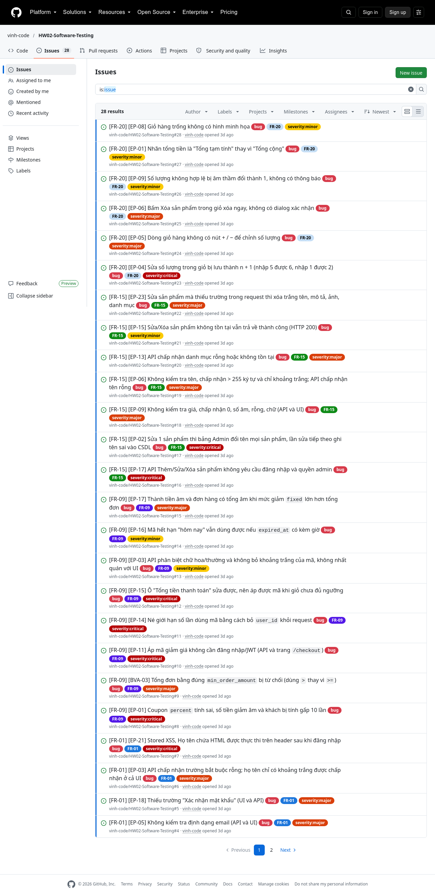
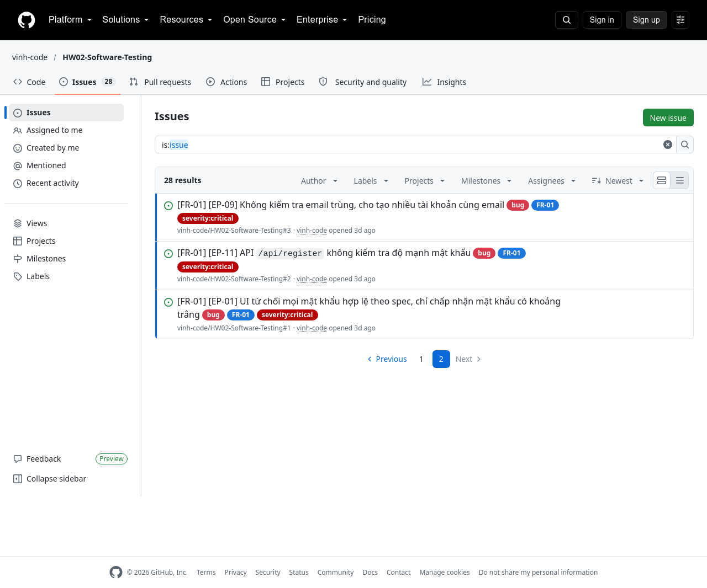
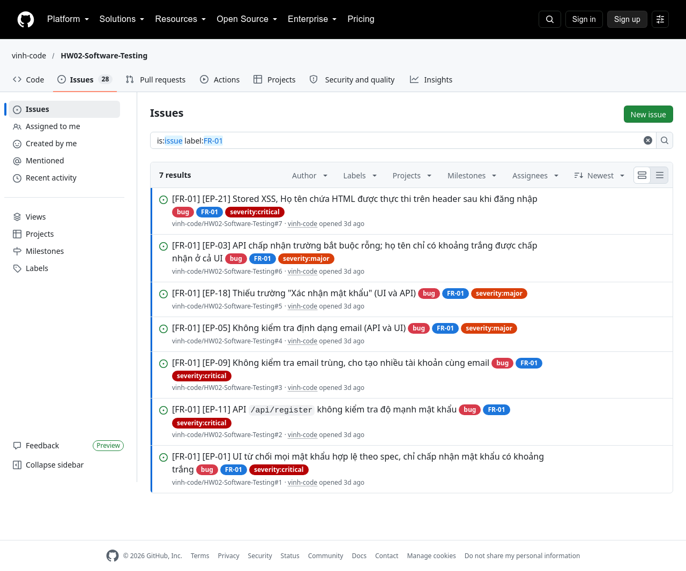
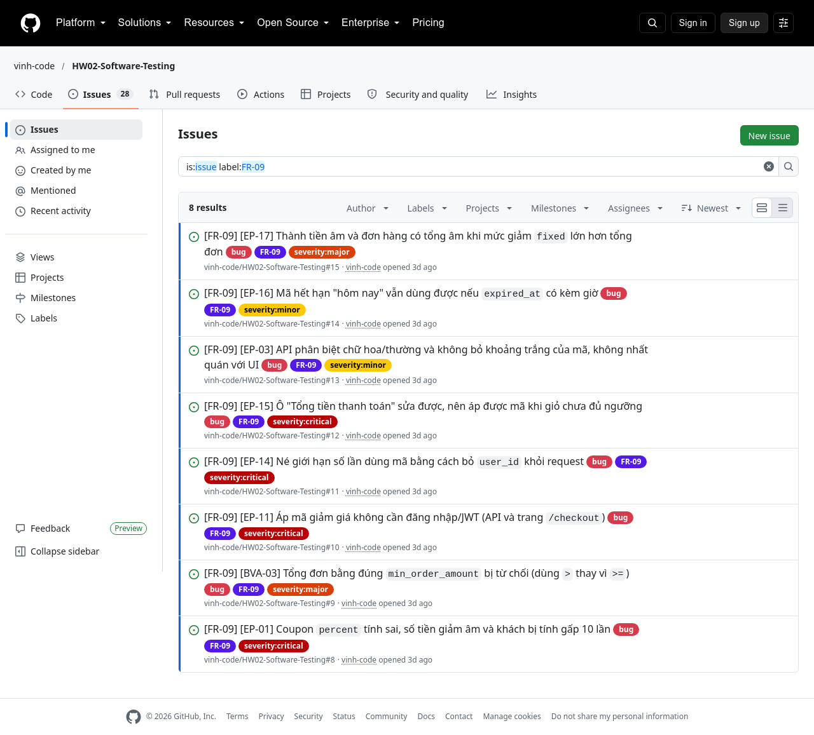
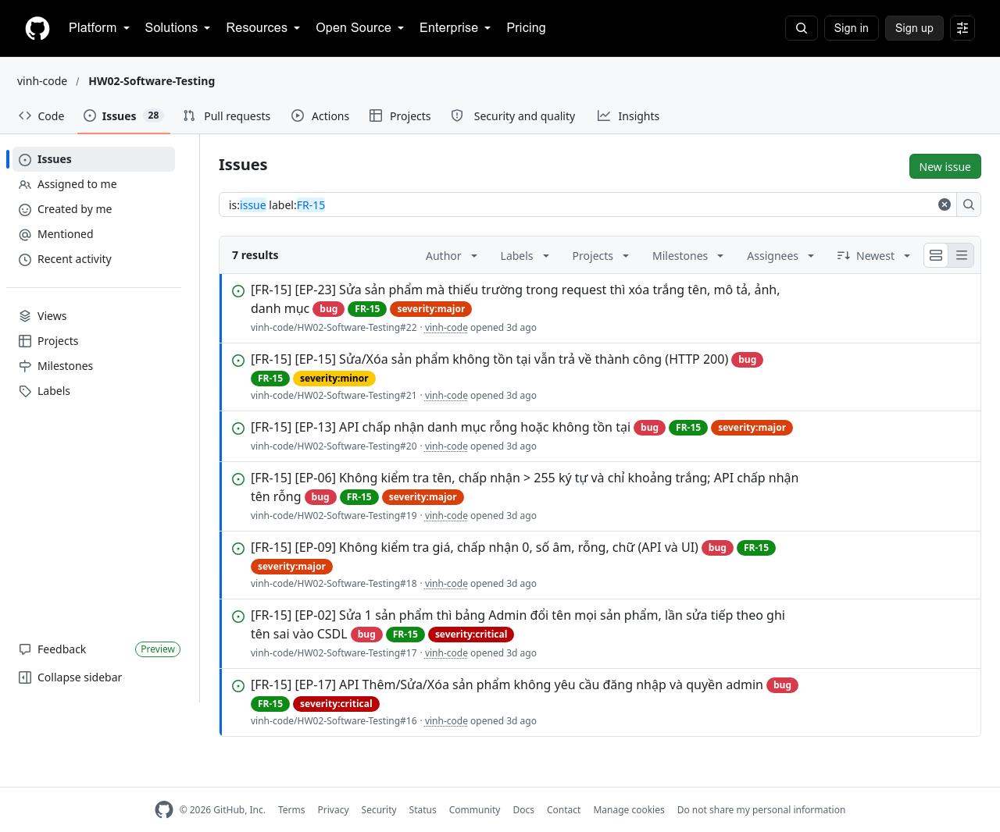
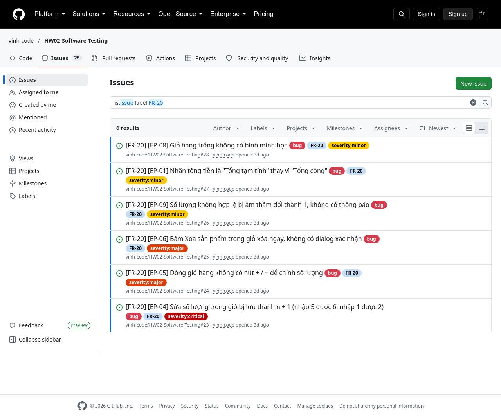

# Danh mục bug (28 bug, GitHub Issues #1–#28)

Báo cáo chi tiết từng bug (bước tái hiện, mong đợi/thực tế, ảnh minh chứng) nằm trong `06_bug_report.md` của mỗi tính năng. Mỗi bug được đồng bộ thành một Issue trên `vinh-code/HW02-Software-Testing`, có tiêu đề `[FR-xx] [Mã TC] …`, nhãn `bug`, `severity:*`, `FR-xx` và ảnh nhúng.

| Tính năng | Bug ID | Tiêu đề | Severity | TC phát hiện | Issue |
|---|---|---|---|---|---|
| FR-01 | [BUG-FR01-01](../features/FR-01_Register/06_bug_report.md) | UI từ chối mọi mật khẩu hợp lệ theo spec, chỉ chấp nhận mật khẩu có khoảng trắng | Critical | EP-01, EP-02, BVA-01/03/04/06/07/09/10/12/13/15/16/18/19/20/21 | [#1](https://github.com/vinh-code/HW02-Software-Testing/issues/1) |
| FR-01 | [BUG-FR01-02](../features/FR-01_Register/06_bug_report.md) | API `/api/register` không kiểm tra độ mạnh mật khẩu | Critical | EP-11, EP-13…EP-17, BVA-05/08/11/14/17 | [#2](https://github.com/vinh-code/HW02-Software-Testing/issues/2) |
| FR-01 | [BUG-FR01-03](../features/FR-01_Register/06_bug_report.md) | Không kiểm tra email trùng, cho tạo nhiều tài khoản cùng email | Critical | EP-09, EP-10, EP-09R, EP-10R | [#3](https://github.com/vinh-code/HW02-Software-Testing/issues/3) |
| FR-01 | [BUG-FR01-04](../features/FR-01_Register/06_bug_report.md) | Không kiểm tra định dạng email (API và UI) | Major | EP-05…EP-07, EP-05R…EP-07R | [#4](https://github.com/vinh-code/HW02-Software-Testing/issues/4) |
| FR-01 | [BUG-FR01-05](../features/FR-01_Register/06_bug_report.md) | Thiếu trường "Xác nhận mật khẩu" (UI và API) | Major | EP-18, EP-19 | [#5](https://github.com/vinh-code/HW02-Software-Testing/issues/5) |
| FR-01 | [BUG-FR01-06](../features/FR-01_Register/06_bug_report.md) | API chấp nhận trường bắt buộc rỗng; họ tên chỉ có khoảng trắng được chấp nhận ở cả UI | Major | EP-03, EP-04, EP-04R, EP-08, EP-12, BVA-02 | [#6](https://github.com/vinh-code/HW02-Software-Testing/issues/6) |
| FR-01 | [BUG-FR01-07](../features/FR-01_Register/06_bug_report.md) | Stored XSS: Họ tên chứa HTML được thực thi trên header sau khi đăng nhập | Critical | EP-21 (TC bổ sung sau gap analysis) | [#7](https://github.com/vinh-code/HW02-Software-Testing/issues/7) |
| FR-09 | [BUG-FR09-01](../features/FR-09_Coupon/06_bug_report.md) | Coupon `percent` tính sai: số tiền giảm âm, khách bị tính gấp 10 lần | Critical | EP-01, EP-03, BVA-01, BVA-04, BVA-09, BVA-10 | [#8](https://github.com/vinh-code/HW02-Software-Testing/issues/8) |
| FR-09 | [BUG-FR09-02](../features/FR-09_Coupon/06_bug_report.md) | Tổng đơn **bằng đúng** `min_order_amount` bị từ chối (dùng `>` thay vì `>=`) | Major | BVA-03, BVA-06 | [#9](https://github.com/vinh-code/HW02-Software-Testing/issues/9) |
| FR-09 | [BUG-FR09-03](../features/FR-09_Coupon/06_bug_report.md) | Áp mã giảm giá không cần đăng nhập/JWT (API và trang `/checkout`) | Critical | EP-11, EP-12 | [#10](https://github.com/vinh-code/HW02-Software-Testing/issues/10) |
| FR-09 | [BUG-FR09-04](../features/FR-09_Coupon/06_bug_report.md) | Né giới hạn số lần dùng mã bằng cách bỏ `user_id` khỏi request | Critical | EP-14 | [#11](https://github.com/vinh-code/HW02-Software-Testing/issues/11) |
| FR-09 | [BUG-FR09-05](../features/FR-09_Coupon/06_bug_report.md) | Ô "Tổng tiền thanh toán" sửa được, nên áp được mã khi giỏ chưa đủ ngưỡng | Critical | EP-15 | [#12](https://github.com/vinh-code/HW02-Software-Testing/issues/12) |
| FR-09 | [BUG-FR09-06](../features/FR-09_Coupon/06_bug_report.md) | API phân biệt chữ hoa/thường và không bỏ khoảng trắng của mã, không nhất quán với UI | Minor | EP-03, EP-04 (kênh API) | [#13](https://github.com/vinh-code/HW02-Software-Testing/issues/13) |
| FR-09 | [BUG-FR09-07](../features/FR-09_Coupon/06_bug_report.md) | Mã hết hạn "hôm nay" vẫn dùng được nếu `expired_at` có kèm giờ (so sánh theo thời điểm, không theo ngày) | Minor | EP-16 (TC bổ sung sau gap analysis) | [#14](https://github.com/vinh-code/HW02-Software-Testing/issues/14) |
| FR-09 | [BUG-FR09-08](../features/FR-09_Coupon/06_bug_report.md) | Thành tiền âm và đơn hàng có tổng âm khi mức giảm `fixed` lớn hơn tổng đơn | Major | EP-17 (TC bổ sung sau gap analysis) | [#15](https://github.com/vinh-code/HW02-Software-Testing/issues/15) |
| FR-15 | [BUG-FR15-01](../features/FR-15_ProductCRUD/06_bug_report.md) | API Thêm/Sửa/Xóa sản phẩm không yêu cầu đăng nhập và quyền admin | Critical | EP-17, EP-18, EP-19, EP-20 | [#16](https://github.com/vinh-code/HW02-Software-Testing/issues/16) |
| FR-15 | [BUG-FR15-02](../features/FR-15_ProductCRUD/06_bug_report.md) | Sửa 1 sản phẩm thì bảng Admin đổi tên **mọi** sản phẩm, lần sửa tiếp theo ghi tên sai vào CSDL | Critical | EP-02, EP-22, BVA-12, BVA-13 | [#17](https://github.com/vinh-code/HW02-Software-Testing/issues/17) |
| FR-15 | [BUG-FR15-03](../features/FR-15_ProductCRUD/06_bug_report.md) | Không kiểm tra giá: chấp nhận 0, số âm, rỗng, chữ (API và UI) | Major | EP-09, EP-10, EP-11, EP-12, EP-22, BVA-08 | [#18](https://github.com/vinh-code/HW02-Software-Testing/issues/18) |
| FR-15 | [BUG-FR15-04](../features/FR-15_ProductCRUD/06_bug_report.md) | Không kiểm tra tên: chấp nhận tên dài hơn 255 ký tự, tên chỉ có khoảng trắng; API chấp nhận tên rỗng | Major | EP-06, EP-07, EP-08, EP-21, BVA-02, BVA-07, BVA-13 | [#19](https://github.com/vinh-code/HW02-Software-Testing/issues/19) |
| FR-15 | [BUG-FR15-05](../features/FR-15_ProductCRUD/06_bug_report.md) | API chấp nhận danh mục rỗng hoặc không tồn tại | Major | EP-13, EP-14 | [#20](https://github.com/vinh-code/HW02-Software-Testing/issues/20) |
| FR-15 | [BUG-FR15-06](../features/FR-15_ProductCRUD/06_bug_report.md) | Sửa/Xóa sản phẩm không tồn tại vẫn trả về thành công (HTTP 200) | Minor | EP-15, EP-16 | [#21](https://github.com/vinh-code/HW02-Software-Testing/issues/21) |
| FR-15 | [BUG-FR15-07](../features/FR-15_ProductCRUD/06_bug_report.md) | Sửa sản phẩm mà thiếu trường trong request thì xóa trắng tên, mô tả, ảnh, danh mục | Major | EP-23 (TC bổ sung sau gap analysis) | [#22](https://github.com/vinh-code/HW02-Software-Testing/issues/22) |
| FR-20 | [BUG-FR20-01](../features/FR-20_Mobile_Cart/06_bug_report.md) | Sửa số lượng trong giỏ bị lưu thành **n + 1** (nhập 5 được 6, nhập 1 được 2) | Critical | EP-04, BVA-07, BVA-08, BVA-09, EP-16R | [#23](https://github.com/vinh-code/HW02-Software-Testing/issues/23) |
| FR-20 | [BUG-FR20-02](../features/FR-20_Mobile_Cart/06_bug_report.md) | Dòng giỏ hàng không có nút **+ / −** để chỉnh số lượng | Major | EP-05, BVA-10, BVA-11, BVA-12 | [#24](https://github.com/vinh-code/HW02-Software-Testing/issues/24) |
| FR-20 | [BUG-FR20-03](../features/FR-20_Mobile_Cart/06_bug_report.md) | Bấm **Xóa** sản phẩm trong giỏ xóa ngay, không có dialog xác nhận | Major | EP-06, EP-07 | [#25](https://github.com/vinh-code/HW02-Software-Testing/issues/25) |
| FR-20 | [BUG-FR20-04](../features/FR-20_Mobile_Cart/06_bug_report.md) | Số lượng không hợp lệ (0, âm, thập phân, chữ, rỗng) bị âm thầm đổi thành 1, không có thông báo | Minor | EP-09…EP-15, EP-17, EP-18, BVA-02, BVA-06 | [#26](https://github.com/vinh-code/HW02-Software-Testing/issues/26) |
| FR-20 | [BUG-FR20-05](../features/FR-20_Mobile_Cart/06_bug_report.md) | Nhãn tổng tiền là "Tổng tạm tính" thay vì "Tổng cộng" | Minor | EP-01 | [#27](https://github.com/vinh-code/HW02-Software-Testing/issues/27) |
| FR-20 | [BUG-FR20-06](../features/FR-20_Mobile_Cart/06_bug_report.md) | Giỏ hàng trống không có hình minh họa | Minor | EP-08 | [#28](https://github.com/vinh-code/HW02-Software-Testing/issues/28) |

**Thống kê:** Critical 11, Major 11, Minor 6

## Ảnh chụp trang GitHub Issues

Repo: https://github.com/vinh-code/HW02-Software-Testing/issues. Có 28 Issue, mỗi Issue gắn nhãn `bug`, `severity:<mức>` và mã tính năng. Ảnh chụp ngày 16/10/2026 bằng `scripts/shot_issues.js`.

### Danh sách tất cả Issue (trang 1/2)

### Danh sách tất cả Issue (trang 2/2)

### Lọc theo tính năng

#### FR-01 Đăng ký (7 Issue)

#### FR-09 Coupon (8 Issue)

#### FR-15 Product CRUD (7 Issue)

#### FR-20 Mobile Giỏ hàng (6 Issue)

